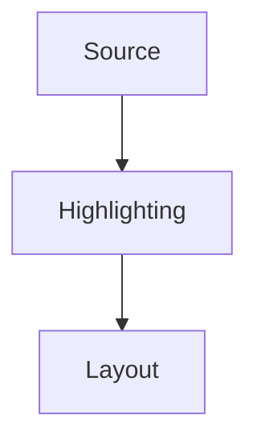

# Documentation site

From the repository root:

```sh
just docs-setup
just docs-dev          # http://127.0.0.1:8001
just docs-check
just docs-build        # output: docs/book/
just docs-serve
just docs-site         # assemble docs/.site/ with version navigation
just docs-serve-site
just docs-deploy       # dispatch the Pages workflow on main; requires gh login
```

Add pages under `src/` and list them in `src/SUMMARY.md`.
Builds use Codly directly from the parent checkout.
Each example has one pre-rendered image on a white page with Typst's default
fonts; theme and font preferences affect only the documentation UI.
The compiler bundles regular and bold faces of DejaVu Sans Mono, Noto Sans Mono,
Source Sans 3, and Libertinus Serif (plus italics for all but Noto Sans Mono,
and DejaVu's obliques); static previews and the live editor share this set.
Noto Color Emoji is bundled for automatic emoji fallback; select it explicitly
with `#set text(font: "Noto Color Emoji")`.
Published versions share content-hashed compiler, renderer, and font URLs under
`_typst/`, so the browser cache reuses identical downloads across the landing
page, releases, and main. Changed bytes get a new URL; existing files remain
available for archived versions. Standalone `book/` builds use local assets.
Caching is plain HTTP — no cookies or JavaScript-managed persistent storage.
Static previews render with up to four parallel workers, limited by available
CPUs; override the pool size with `CODLY_DOCS_WORKERS`, for example
`CODLY_DOCS_WORKERS=2 just docs-build`.
Third-party runtime and font assets are pinned submodules; `just docs-setup`
initializes them. For a fresh clone, use `git clone --recurse-submodules`.

Elembic declaration metadata lives in [`src/args.yaml`](../src/args.yaml),
grouped by element and custom type, with shared callout fields. Types and
defaults are quoted Typst expressions; field traits are YAML booleans, and
field order determines positional arguments. Descriptions belong there;
examples belong in the manual. Casts, parsers, and renderers remain in Typst.

Use `typst preview` fences for editable examples. Add `fixed` for a full-width
example with highlighted code above its pre-rendered SVG:

`````markdown
````typst preview fixed
#import "@preview/codly:2.0.0" as codly
#codly.new[
```rust
let answer = 42;
```
]
````
`````

Fixed examples support copying, with no editor or live rendering. Put defaults
directly in their source; `yaml widgets` is reserved for interactive examples.

## Collapsible sections

Wrap a concept in a native disclosure to keep long guides easy to scan:

`````markdown
::: collapse Port the old setting {#port-setting}

Explain the old behavior, then show its replacement.

```yaml widgets
- type: switch
  name: show-numbers
  label: Show line numbers
  default: true
```
````typst preview
#import "@preview/codly:2.0.0" as codly
#codly.new(
  ```py
  print(42)
  ```,
  number-enabled: show-numbers,
)
````

:::
`````

Use `collapse-open` to start expanded. Titles are plain text; the body supports
Markdown, tables, links, admonitions, diagrams, and editable examples.
Keep each `yaml widgets` fence immediately before its preview fence.

Sections can nest and are closed by default. Give each concept a stable
`{#id}` for links; omitted ids use unique title slugs. The title appears in the
page contents, and fragment links open the target and any enclosing sections.
Expansion works without JavaScript. Start delimiters at the beginning of a
line; markers inside code fences stay literal.

## Deployment

The source workflow publishes generated files to the `gh-pages` branch of
[Dherse/codly.github.io](https://github.com/Dherse/codly.github.io).

1. Create a fine-grained personal access token restricted to `Dherse/codly.github.io`,
   with **Contents: Read and write**.
2. In `Dherse/codly`, add it as the Actions secret `DOCS_DEPLOY_TOKEN`.
3. Merge the workflow into `main`. Its push publishes the first build; use
   `just docs-deploy` to run it manually.
4. After `gh-pages` exists, in `Dherse/codly.github.io` select
   **Settings → Pages → Source → Deploy from a branch → gh-pages → /(root)**.

The default Pages URL is `https://dherse.github.io/codly.github.io/` (a project
site, since the repository owner is `Dherse`). All site links are relative, so a
later custom domain needs no URL rewrite.

`site.json` configures `customDomain` as `codly.dherse.dev`. Site assembly writes
the root `CNAME` on every deployment, restoring it if a previous build deleted it.
Without `customDomain`, assembly preserves the hosting branch's existing `CNAME`.
Archived releases cannot overwrite the hosting domain. Set the same domain in
the hosting repository's **Settings → Pages → Custom domain**.

Main pushes update `/main/`; the release workflow builds `/vX.Y.Z/` after
validation and backfills missing release tags from `initialVersion` onward.
The hosting branch retains published versions across deployments.

`site.json` sets the default version. `"latest"` opens the highest published stable
release; replace it with a tag such as `"v2.0.0"` to pin the landing site.
`initialVersion` seeds the first release from main only when its package version
matches and no archive exists; the actual release tag then rebuilds that snapshot.

To backfill an existing tag, run **Deploy documentation** with `release_ref` set
to that tag. Tags without the site scaffold get the current scaffold with their
own Codly source; later tags use their own documentation and runtime.

## Notes, tips, and warnings

Use a blockquote with a marker on its first line:

```markdown
> [!WARNING]
> A highlight palette must contain at least one color.

> [!TIP] Choosing a palette
> Use **five colors** for a repeating cycle. Links, lists, and code fences
> work inside the box; prefix each line with `>`.
```

The supported markers are `[!NOTE]`, `[!TIP]`, `[!IMPORTANT]`, `[!WARNING]`,
and `[!CAUTION]`. An optional title after the marker replaces the default
heading. Ordinary blockquotes and markers inside code fences stay unchanged.
The boxes render at build time and work without JavaScript in both themes.

## Diagrams

Use `mermaid` fences with an accessible title and description:



Mermaid loads from the local build only on pages containing diagrams and follows
the current light or dark theme. Diagram source remains available when JavaScript
is disabled or rendering fails. Wide diagrams scroll inside their own panel.
