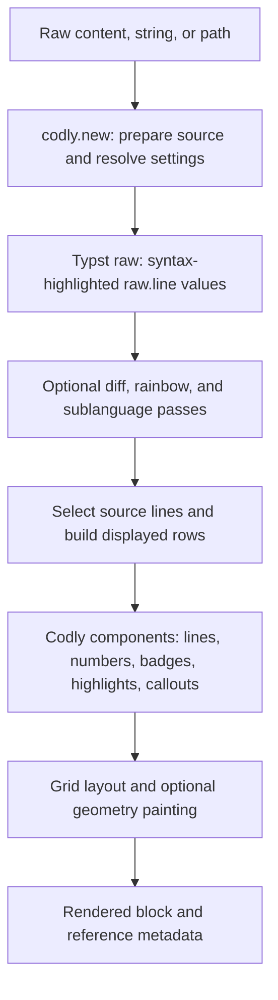
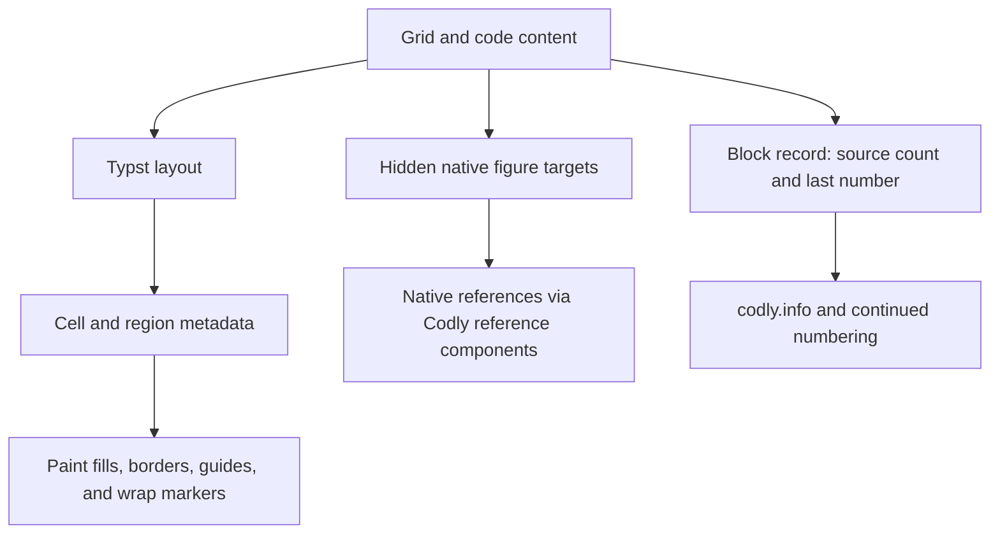

# How Codly works

Codly keeps Typst's syntax highlighting and builds a configurable layout around
it. This guide follows the current implementation from source to output, so you
can choose the right extension point when a theme or field is not enough. For
writing rules and queries, see [Querying and show rules](queries-and-show-rules.md).

## From source to components

[`codly.new`](components/new.md) is an alias for the block element `codly.codly`.
It accepts raw content, a source string, or a resolved `path`. Strings and files
become block `raw` elements; filenames can supply a language and file badge.
Typst then produces `raw.line` values containing both plain text and highlighted
content.



The components are [Elembic](https://pgbiel.github.io/elembic/) custom elements.
Elembic validates fields, casts shorthand configuration values, and resolves
scoped set/show rules when elements are displayed. That is why
`#show: codly.number-set_(...)` can style numbers generated later by the block
renderer. [Themes](helpers/theme.md) apply these same scoped rules, alongside raw
syntax and text styling.

## Syntax passes reuse Typst

Codly does not implement another language parser. Extra highlighting features
create auxiliary raw blocks and retain their highlighted lines:

- **Sublanguages** highlight each configured source range with its own language.
  [`codly.sublang-block`](components/sublang-block.md) stores those lines as
  metadata; the visible row receives the resolved `raw.line` before its line
  show rule runs.
- **Rainbow delimiters** use a private classification theme to distinguish code
  from strings and comments, then recolor eligible delimiters in the display
  content. Sublanguage ranges receive their own classification passes.
- **Diffs** (`diff-py` or `diff,py`, for example) create old and new source views
  for each hunk. Removed rows use old-side highlighting; added and context rows
  use new-side highlighting. The final block adds backgrounds and gutters once.

These passes can nest: a diff view can contain sublanguages and rainbow colors.
Auxiliary blocks provide syntax data rather than extra visible listings. They
can still appear in broad element queries, so a count of queried Codly or raw
elements need not equal a count of visible listings.

## Source lines become grid rows

The row builder applies ranges, skips, offsets, and unnumbered-line settings. It
then inserts callout rows and constructs gutter, code, and optional annotation
cells. Annotations can span rows; headers and footers span the columns.

Keep three coordinates separate:

| Coordinate | Used for |
| --- | --- |
| Source line, starting at 1 | Ranges, sublanguages, gutter arrays, callout attachment |
| Displayed number | Number labels and highlight line selection |
| Displayed row index, starting at 0 | Fill palettes and row callbacks, including generated rows |

Here the second source line displays as `102`. Its gutter entry and callout use
source coordinates; its highlight uses the displayed number.

````typst preview
#import "@preview/codly:2.0.0" as codly

#codly.new(
  ```py
  x = 1
  print(x)
  ```,
  offset: 100,
  gutters: (auto, ("", "→")),
  highlights: ((line: 102, start: 1, end: 5),),
  callouts: ((line: 2, body: [The second source line.]),),
)
````

A wrapped line remains one logical code row. Smart indentation formats its
continuations inside that row. Body backgrounds normally come from
[`codly.line`](components/line.md); whole-line highlights take precedence over
diff backgrounds, which take precedence over the ordinary fill. Header and
footer components own their fills.

## Layout, metadata, and references

For ordinary blocks, Typst lays out the grid directly. Outside gutters, indent
guides, wrap markers, or edge padding use the geometry renderer: metadata marks
cell and page-region boundaries, then painting uses their actual positions.
This lets decorations follow wrapped rows and page breaks without laying out a
second copy of the code.



Line, highlight, and annotation references use hidden native figure targets,
while [`codly.line-ref`](components/line-ref.md) and the other reference
components format the resulting reference text. The enclosing figure label is
discovered automatically; an unlabeled inner figure stops that discovery.

[`codly.info`](helpers/info.md) reads the compact block record inside `context`.
Its `lines` field counts the full source, including omitted lines; `last-number`
tracks computed numbering. Passing a previous block's label as `offset` uses
that record to continue numbering.

## Finding an extension point

Start with public fields and themes for layout and appearance. Use component
show rules for a badge, line, highlight, or reference; keep the original element
in your result when you want its existing behavior. Query metadata for document
inspection after layout.

For implementation work, field types, defaults, and descriptions live in
[`src/args.yaml`](https://github.com/Dherse/codly/blob/main/src/args.yaml).
[`src/declarations.typ`](https://github.com/Dherse/codly/blob/main/src/declarations.typ)
loads this metadata for the constructors, casts, and renderers in
[`codly.typ`](https://github.com/Dherse/codly/blob/main/codly.typ).
The row and block pipeline lives in
[`src/lib.typ`](https://github.com/Dherse/codly/blob/main/src/lib.typ), and the
position-based painting in
[`src/geometry.typ`](https://github.com/Dherse/codly/blob/main/src/geometry.typ).
Fields and labels beginning with `__` carry internal data and may change; build
customizations on the documented API.
